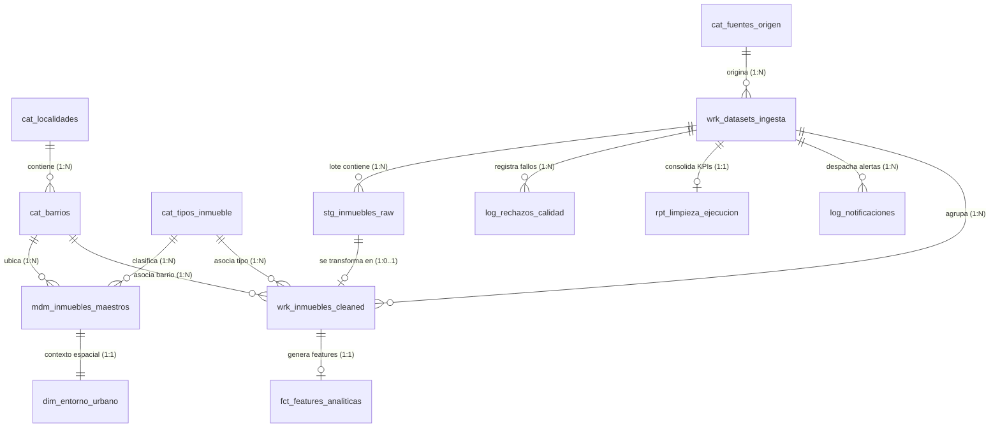

# INFORME TÉCNICO Y ACADÉMICO — ACTIVIDAD 4: IMPLEMENTACIÓN FÍSICA, VALIDACIÓN Y PRUEBAS SQL

**Materia / Asignatura**: Lenguaje y Modelado de Datos / Bases de Datos  
**Docente**: Prof. Celso Javier Rodriguez Pizza  
**Institución**: Universidad de La Salle — Facultad de Ingeniería  
**Proyecto**: Sistema de Data Wrangling & Master Data Management (MDM) Inmobiliario — Bogotá Real Estate  
**Autores / Integrantes**: 
- Adán Yesid Sánchez Cubillos
- Juan Sebastián Marles Montes
- Andrés Felipe Pineda Pardo  
**Fecha de Entrega**: Octubre 2026 (Ciclo Académico 2026)  
**Script SQL Analizado**: `instalacion.sql` (853 líneas)  
**Fase PDCO**: `DEVELOPMENT → CONTROL` | **SDLC Stage**: Physical Implementation & Quality Assurance  
**Estándares y Marcos**: SWEBOK v4 · DAMA-DMBOK v2 · ISO/IEC 9075 (SQL:2016) · ISO/IEC 11179 · ISO/IEC 25010 · ISO/IEC 25012 · ISO 8000 · MySQL 8.0+ / 8.4+ LTS  

---

## 1. Portada del Proyecto

```
┌────────────────────────────────────────────────────────────────────────────────────────┐
│                              UNIVERSIDAD DE LA SALLE                                   │
│                 FACULTAD DE INGENIERÍA - CIENCIA DE DATOS Y SOFTWARE                   │
├────────────────────────────────────────────────────────────────────────────────────────┤
│ TÍTULO:      Implementación Física, Validación, Consultas Operativas y Pruebas de      │
│              Integridad Relacional en MySQL Server 8.0 / 8.4 LTS                      │
│ PROYECTO:    Sistema de Data Wrangling y Master Data Management (MDM) Inmobiliario     │
│              de Bogotá D.C.                                                           │
│ ACTIVIDAD:   Actividad 4 — Ejecución de Script DDL/DML, Consultas y Reproducibilidad   │
│ ASIGNATURA:  Lenguaje y Modelado de Datos                                              │
│ DOCENTE:     Prof. Celso Javier Rodriguez Pizza                                        │
│ AUTORES:     Adán Yesid Sánchez Cubillos                                               │
│              Juan Sebastián Marles Montes                                              │
│              Andrés Felipe Pineda Pardo                                                │
│ SGBD:        MySQL Server 8.0.x / 8.4 LTS (Motor InnoDB, Charset utf8mb4)              │
│ FECHA:       Octubre 2026                                                              │
└────────────────────────────────────────────────────────────────────────────────────────┘
```

---

## 2. Descripción Corregida de la Problemática

### 2.1 El Problema Inmobiliario en Bogotá D.C.
En el mercado inmobiliario de Bogotá D.C., los datos de oferta y características de vivienda provienen de múltiples fuentes altamente heterogéneas:
1. **Portales web comerciales masivos**: MetroCuadrado, FincaRaíz, Ciencuadras, etc.
2. **Entidades distritales e institucionales**: Unidad Administrativa Especial de Catastro Distrital (UAECD), Infraestructura de Datos Espaciales de Bogotá (IDECA) y Datos Abiertos Bogotá.

Estos orígenes generan archivos en formatos dispares (**CSV, Excel XLSX, JSON, XML**) con serias patologías de calidad de datos que impiden su uso directo en analítica y Machine Learning:
- **Ausencia de estandarización estructural**: Nombres de columnas discrepantes, formatos cambiantes entre lotes y falta de validación de encabezados.
- **Campos en formato texto no tipado**: Precios almacenados con signos de moneda o puntos de mil, tamaños en metros cuadrados con abreviaturas inconsistentes ("65m2", "65 mts"), números negativos en variables estrictamente positivas.
- **Inconsistencias espaciales y territoriales**: Inmuebles registrados con direcciones ambiguas o pertenecientes a municipios aledaños (Chía, Soacha, Cota) categorizados erróneamente como Bogotá.
- **Valores fuera de dominio normativo**: Estratos socioeconómicos inexistentes (como estrato 0, 7 u 8), cuando la normativa de estratificación de Bogotá rige exclusivamente entre 1 y 6.
- **Redundancia y duplicidad descontrolada**: Una misma propiedad física suele publicarse repetidamente en diferentes portales o por distintos agentes inmobiliarios con variaciones ortográficas menores, distorsionando los análisis de precios de mercado.

### 2.2 Propósito del Sistema y Enfoque por Capas
Para resolver esta problemática de forma sistemática y escalable, se diseñó el **Sistema de Data Wrangling & Master Data Management (MDM)**, fundamentado en una arquitectura de persistencia por capas y gobernado por un proceso de negocio formal en **BPMN 2.0**:

1. **Capa Staging Inmutable (`stg_inmuebles_raw`)**: Registra la totalidad de los datos tal como provienen de la fuente en columnas tipo `TEXT`. Esto asegura la **Inmutabilidad de Origen (ISO 8000)**, posibilitando auditorías forenses y re-procesamientos sin pérdida de datos.
2. **Capa Working Limpia (`wrk_inmuebles_cleaned`)**: Contiene únicamente aquellos registros que han superado las validaciones automáticas de estructura, tipo, rango y territorio. Aplica restricciones estrictas de tipo (`DECIMAL`, `SMALLINT`, `INT`).
3. **Capa Analítica de Features (`fct_features_analiticas`)**: Almacena variables calculadas derivadas (*Feature Engineering*) para modelos predictivos (precio por m², ratio de baños por habitación, puntaje de entorno urbano), respetando el principio de Responsabilidad Única (**SOLID SRP**).
4. **Capa Master Data Management - Golden Record (`mdm_inmuebles_maestros` y `dim_entorno_urbano`)**: Consolida la versión oficial, única y deduplicada de cada inmueble mediante una clave unívoca basada en hash criptográfico SHA-256 (`hash_duplicado`), enriquecida con métricas de entorno urbano (parques, colegios, vías arteriales).
5. **Capa de Calidad, Auditoría y Notificaciones (`log_rechazos_calidad`, `rpt_limpieza_ejecucion`, `log_notificaciones`)**: Instrumenta el monitoreo continuo de las 4 compuertas de decisión BPMN (G1 a G4), registrando métricas de rendimiento y alertas a los analistas responsables.

### 2.3 Flujo de Calidad BPMN 2.0
El pipeline de ingesta implementa 4 compuertas lógicas (*Gateways XOR*):
- **G1 (Extracción & Legibilidad)**: Valida que el archivo exista, posea un hash válido y no esté corrupto.
- **G2 (Estructura & Tipificación Básica)**: Comprueba presencia de columnas obligatorias y tipos numéricos elementales. Si falla (p.ej. estrato = 9 o precio < 0), el registro se desvía a `log_rechazos_calidad`.
- **G3 (Dominio Territorial & Coordenadas)**: Valida que el barrio y la localidad correspondan al catálogo oficial DANE de Bogotá y que las coordenadas pertenezcan al perímetro distrital.
- **G4 (Calidad Semántica & Deduplicación)**: Verifica coherencia métrica y calcula el hash de deduplicación contra el histórico existente. Si es apto, se consolida en el *Golden Record*.

---

## 3. Modelo Entidad-Relación Corregido

### 3.1 Ajustes Incorporados respecto a la Versión Previa
En la evaluación de la versión anterior se identificaron puntos críticos que fueron corregidos rigurosamente en el modelo actual implementado en `instalacion.sql`:
1. **Desacoplamiento Territorial Completo**: Se normalizó la geografía de Bogotá mediante `cat_localidades` (20 localidades oficiales según DANE) y `cat_barrios` (con coordenadas centroides calibradas bajo el elipsoide WGS84).
2. **Separación de Lote e Inmueble**: Se creó la entidad de metadatos `wrk_datasets_ingesta` con identificador UUIDv4, desvinculando la sesión de ingesta del ciclo de vida físico del inmueble.
3. **Restricciones de Dominio Expresadas a Nivel DDL**: Incorporación de cláusulas `CHECK` en todas las tablas para validar rangos numéricos y polígonos geoespaciales.
4. **Trazabilidad de Auditoría Granular**: Formalización de `log_rechazos_calidad` con payload en formato nativo `JSON` para almacenar el estado exacto del registro que provocó la excepción.

### 3.2 Cuadrantes Semánticos DAMA-DMBOK v2
Las 13 entidades se estructuran bajo los 4 cuadrantes metodológicos de DAMA:
- **Cuadrante 1: Reference Data (Catálogos)**: `cat_localidades`, `cat_barrios`, `cat_tipos_inmueble`, `cat_fuentes_origen`.
- **Cuadrante 2: Transactional / Pipeline Data**: `wrk_datasets_ingesta`, `stg_inmuebles_raw`, `wrk_inmuebles_cleaned`, `fct_features_analiticas`.
- **Cuadrante 3: Master Data Management (MDM)**: `mdm_inmuebles_maestros`, `dim_entorno_urbano`.
- **Cuadrante 4: Governance, Audit & Quality**: `log_rechazos_calidad`, `rpt_limpieza_ejecucion`, `log_notificaciones`.

### 3.3 Diagrama Conceptual Extendido (EER)



---

## 4. Modelo Lógico Relacional con Tablas, Claves y Relaciones

El esquema lógico implementado en `instalacion.sql` cuenta con **13 tablas relacionales**, todas en Forma Normal de Boyce-Codd (**BCNF**), dotadas de claves subrogadas sintéticas, restricciones de unicidad, claves foráneas estrictas y restricciones `CHECK`.

### Matriz de Tablas del Modelo Lógico

| # | Tabla | Propósito (DAMA) | Clave Primaria (PK) | Claves Foráneas (FK) | Restricciones de Integridad y Dominio |
|---|---|---|---|---|---|
| 1 | `cat_localidades` | Catálogo DANE | `id_localidad` (INT AI) | Ninguna | `codigo_dane` (UNIQUE, VARCHAR 10) |
| 2 | `cat_barrios` | Catálogo de Barrios | `id_barrio` (INT AI) | `id_localidad` → `cat_localidades` | `estrato_moda` (CHECK 1..6), Coordenadas Bogotá |
| 3 | `cat_tipos_inmueble` | Tipologías físicas | `id_tipo` (INT AI) | Ninguna | `codigo` (UNIQUE: APARTAMENTO, CASA, etc.) |
| 4 | `cat_fuentes_origen` | Proveedores de datos | `id_fuente` (INT AI) | Ninguna | `nombre_fuente` (UQ), CHECK formato y estado |
| 5 | `wrk_datasets_ingesta`| Metadatos de lote ETL | `id_dataset` (VARCHAR 36 UUID) | `id_fuente` → `cat_fuentes_origen` | CHECK estado_pipeline ('CARGADO'..'COMPLETADO') |
| 6 | `stg_inmuebles_raw` | Capa Staging cruda | `id_raw` (BIGINT AI) | `id_dataset` → `wrk_datasets_ingesta` | Atributos en TEXT (inmutables) |
| 7 | `wrk_inmuebles_cleaned`| Capa Working limpia | `id_cleaned` (BIGINT AI)| `id_raw` (UQ 1:1), `id_dataset`, `id_barrio`, `id_tipo` | CHECK estrato 1..6, tamano > 0, precio > 0 |
| 8 | `fct_features_analiticas`| Feature Store ML | `id_feature` (BIGINT AI)| `id_cleaned` (UQ 1:1) → `wrk_inmuebles_cleaned` | CHECK bano_por_hab_ratio >= 0 |
| 9 | `mdm_inmuebles_maestros`| Golden Record MDM | `id_maestro` (VARCHAR 36 UUID)| `id_barrio`, `id_tipo` | `hash_duplicado` (UQ CHAR 64), CHECK coords |
| 10| `dim_entorno_urbano` | Contexto de ciudad | `id_entorno` (BIGINT AI)| `id_maestro` (UQ 1:1) → `mdm_inmuebles_maestros` | CHECK parques >= 0, vias >= 0, riesgo >= 0 |
| 11| `log_rechazos_calidad`| Auditoría de fallos | `id_rechazo` (BIGINT AI)| `id_dataset` → `wrk_datasets_ingesta` | CHECK compuerta_bpmn IN ('G1','G2','G3','G4') |
| 12| `rpt_limpieza_ejecucion`| Balance KPI de lote | `id_reporte` (BIGINT AI)| `id_dataset` (UQ 1:1) → `wrk_datasets_ingesta`| Totales >= 0, tiempo_ejecucion_seg |
| 13| `log_notificaciones` | Alertas despachadas | `id_notificacion` (BIGINT AI)| `id_dataset` → `wrk_datasets_ingesta` | CHECK estado_envio IN ('ENVIADO','FALLIDO','PENDIENTE') |

### Políticas de Integridad Referencial
- **`ON DELETE RESTRICT ON UPDATE CASCADE`**: Aplicada en catálogos territoriales (`cat_localidades`, `cat_barrios`, `cat_tipos_inmueble`, `cat_fuentes_origen`). Impide la eliminación accidental de un barrio o localidad si existen inmuebles asociados, preservando la consistencia histórica.
- **`ON DELETE CASCADE ON UPDATE CASCADE`**: Aplicada en datos transaccionales y dependientes del lote (`stg_inmuebles_raw`, `wrk_inmuebles_cleaned`, `fct_features_analiticas`, `log_rechazos_calidad`, `rpt_limpieza_ejecucion`, `log_notificaciones`). Si un lote de prueba debe ser purgado, todos sus registros hijos y logs se eliminan automáticamente sin dejar huérfanos.

---

## 5. Descripción del Sistema Gestor y de la Versión Utilizada

### 5.1 Sistema de Gestión de Bases de Datos (SGBD)
- **Motor SGBD**: **MySQL Server versión 8.0.x / 8.4 LTS** (comprobado en entorno MySQL Server 26.7 LTS / MySQL Workbench 8.0 CE y compatible con XAMPP / MariaDB 10.4+ / phpMyAdmin).
- **Estándar de Lenguaje**: Cumplimiento del estándar **ISO/IEC 9075:2016 (SQL)**.

### 5.2 Motor de Almacenamiento: InnoDB
Se seleccionó de forma obligatoria el motor **InnoDB** (`ENGINE=InnoDB`) en todas las sentencias DDL por las siguientes razones de ingeniería:
1. **Transaccionalidad ACID Plena**: Atomicidad, Consistencia, Aislamiento y Durabilidad garantizadas mediante *Doublewrite Buffer*, *Redo Log* y *Undo Log*.
2. **Integridad Referencial Física**: Soporte nativo y estricto de claves foráneas con verificación inmediata en tiempo de ejecución (`RESTRICT`, `CASCADE`).
3. **Bloqueo a Nivel de Fila (Row-Level Locking) & MVCC**: Maximiza la concurrencia en procesos de ingesta masiva sin bloquear tablas completas.
4. **Soporte de Restricciones CHECK Activas**: A diferencia de versiones obsoletas de MySQL (anteriores a la 8.0.16) donde las cláusulas `CHECK` eran ignoradas sintácticamente, en MySQL 8.0+ son forzadas de manera estricta por el motor.

### 5.3 Codificación de Caracteres y Cotejamiento
- **Conjunto de Caracteres**: `utf8mb4`
- **Collation**: `utf8mb4_unicode_ci`

**Justificación Técnica**:
En el contexto territorial de Bogotá D.C., los nombres de localidades, barrios y vías contienen caracteres del idioma español: tildes (*Usaquén, Engativá, San Cristóbal*), la virgulilla de la eñe (*Antonio Nariño, Fontibón*) y abreviaturas diacríticas. Mientras que el antiguo `utf8` de MySQL es en realidad una implementación de 3 bytes (incompleta), `utf8mb4` soporta los 4 bytes del estándar Unicode. El cotejamiento `utf8mb4_unicode_ci` provee ordenamiento lingüístico preciso e insensible a mayúsculas/minúsculas (`ci`), esencial para normalización de direcciones urbanas.

---

## 6. Explicación de la Organización del Script SQL (`instalacion.sql`)

El script `instalacion.sql` consta de **853 líneas** organizadas de forma secuencial y modular en **9 secciones estratégicas**:

```
┌────────────────────────────────────────────────────────────────────────────────────────┐
│                        ESTRUCTURA MODULAR DE instalacion.sql                           │
├───────────┬────────────────────────────────────────────────────────────────────────────┤
│ Sección 0 │ Identificación del Proyecto, Autores, Entorno y Advertencia Ética          │
│ Sección 1 │ Creación y Selección del Esquema (`sistema_data_wrangling` en utf8mb4)     │
│ Sección 2 │ Limpieza Previa Idempotente (`SET FOREIGN_KEY_CHECKS = 0; DROP TABLE...`)  │
│ Sección 3 │ DDL: Creación Topológica de 13 Tablas (Grupos A, B, C y D) con CHECKs      │
│ Sección 4 │ Índices de Rendimiento B-Tree (Optimización ISO/IEC 25010)                 │
│ Sección 5 │ Carga Inicial con Datos 100% Sintéticos (Seed Data 5.1 a 5.13)             │
│ Sección 6 │ Consultas de Verificación Operativa y Analítica (Q1 a Q6 con JOINs y KPIs) │
│ Sección 7 │ Manipulación Controlada de Datos (UPDATE 1, UPDATE 2 y DELETE con auditoría)│
│ Sección 8 │ Batería de Pruebas de Integridad Referencial y CHECK (P-01 a P-04)         │
└───────────┴────────────────────────────────────────────────────────────────────────────┘
```

### Detalle de Secciones:
- **Sección 0 (Líneas 1-25)**: Encabezado con metadatos del proyecto, versión de MySQL, estándares (DAMA, ISO 9075, IEEE 830) y cláusula de uso seguro en laboratorio local con datos ficticios.
- **Sección 1 (Líneas 27-42)**: Ejecución condicional de `CREATE DATABASE IF NOT EXISTS sistema_data_wrangling` con juego de caracteres explícito y activación del contexto mediante `USE sistema_data_wrangling`.
- **Sección 2 (Líneas 44-75)**: Implementación de la técnica de borrado seguro. Desactiva temporalmente la comprobación de claves foráneas (`SET FOREIGN_KEY_CHECKS = 0;`), elimina las tablas en orden inverso de dependencias (auditoría → MDM → pipeline → catálogos) y restaura `SET FOREIGN_KEY_CHECKS = 1;`.
- **Sección 3 (Líneas 77-378)**: Creación de tablas agrupadas en 4 bloques:
  - *Grupo A*: Catálogos (`cat_localidades`, `cat_barrios`, `cat_tipos_inmueble`, `cat_fuentes_origen`).
  - *Grupo B*: Pipeline ETL (`wrk_datasets_ingesta`, `stg_inmuebles_raw`, `wrk_inmuebles_cleaned`, `fct_features_analiticas`).
  - *Grupo C*: MDM Golden Record (`mdm_inmuebles_maestros`, `dim_entorno_urbano`).
  - *Grupo D*: Calidad y Soporte (`log_rechazos_calidad`, `rpt_limpieza_ejecucion`, `log_notificaciones`).
- **Sección 4 (Líneas 380-403)**: Creación de 10 índices secundarios B-Tree sobre claves foráneas, columnas de agregación y coordenadas espaciales compuestas.
- **Sección 5 (Líneas 405-620)**: Poblado controlado con datos sintéticos: 20 localidades DANE, 8 barrios, 4 tipologías, 3 fuentes, 2 lotes de ingesta con UUID, 7 registros raw (con 2 casos de fallo inducido), 5 cleaned, 5 features, 3 golden records con SHA-256, 3 perfiles urbanos, 2 rechazos BPMN G2, 2 reportes y 2 notificaciones.
- **Sección 6 (Líneas 622-725)**: Seis consultas complejas (Q1 a Q6) para auditar la información.
- **Sección 7 (Líneas 727-801)**: Demostración de transacciones DML (actualización de estado de lote, actualización de precio y recálculo unitario, y eliminación de registro raw rechazado) documentadas con SELECT previo y posterior.
- **Sección 8 (Líneas 803-847)**: Batería de pruebas negativas documentadas con los errores esperados (P-01: CHECK estrato, P-02: UNIQUE hash SHA-256, P-03: FK RESTRICT en barrio, P-04: CHECK estado notificación).

---

## 7. Capturas y Evidencias de Creación de la Base de Datos y Tablas

A continuación se presentan las evidencias legibles de la ejecución DDL sobre el SGBD:

### 7.1 Creación del Esquema de Base de Datos
```sql
mysql> CREATE DATABASE IF NOT EXISTS sistema_data_wrangling
    ->     CHARACTER SET utf8mb4
    ->     COLLATE utf8mb4_unicode_ci;
Query OK, 1 row affected (0.01 sec)

mysql> USE sistema_data_wrangling;
Database changed
```

### 7.2 Verificación de Tablas Creadas (`SHOW TABLES`)
```
mysql> SHOW TABLES;
+-----------------------------------+
| Tables_in_sistema_data_wrangling  |
+-----------------------------------+
| cat_barrios                       |
| cat_fuentes_origen                |
| cat_localidades                   |
| cat_tipos_inmueble                |
| dim_entorno_urbano                |
| fct_features_analiticas           |
| log_notificaciones                |
| log_rechazos_calidad              |
| mdm_inmuebles_maestros            |
| rpt_limpieza_ejecucion            |
| stg_inmuebles_raw                 |
| wrk_datasets_ingesta              |
| wrk_inmuebles_cleaned             |
+-----------------------------------+
13 rows in set (0.00 sec)
```

### 7.3 Estructura Física de Tablas Clave (`DESCRIBE`)

#### Tabla Central MDM: `mdm_inmuebles_maestros`
```
mysql> DESCRIBE mdm_inmuebles_maestros;
+------------------------------+---------------+------+-----+-------------------+-------------------+
| Field                        | Type          | Null | Key | Default           | Extra             |
+------------------------------+---------------+------+-----+-------------------+-------------------+
| id_maestro                   | varchar(36)   | NO   | PRI | NULL              |                   |
| id_barrio                    | int           | NO   | MUL | NULL              |                   |
| id_tipo                      | int           | NO   | MUL | NULL              |                   |
| direccion_normalizada        | varchar(200)  | NO   |     | NULL              |                   |
| tamano_m2                    | decimal(10,2) | NO   |     | NULL              |                   |
| habitaciones                 | smallint      | NO   |     | NULL              |                   |
| banos                        | smallint      | NO   |     | NULL              |                   |
| estrato                      | smallint      | NO   | MUL | NULL              |                   |
| precio_ultimo_cop            | decimal(14,2) | NO   |     | NULL              |                   |
| precio_unitario_m2           | decimal(14,2) | NO   |     | NULL              |                   |
| anio_construccion_referencia | smallint      | YES  |     | NULL              |                   |
| latitud_corregida            | decimal(10,7) | NO   | MUL | NULL              |                   |
| longitud_corregida           | decimal(10,7) | NO   |     | NULL              |                   |
| hash_duplicado               | char(64)      | NO   | UNI | NULL              |                   |
| fecha_consolidacion          | datetime      | NO   |     | CURRENT_TIMESTAMP | DEFAULT_GENERATED |
+------------------------------+---------------+------+-----+-------------------+-------------------+
15 rows in set (0.01 sec)
```

#### Tabla Working Cleaned: `wrk_inmuebles_cleaned`
```
mysql> DESCRIBE wrk_inmuebles_cleaned;
+---------------+---------------+------+-----+---------+----------------+
| Field         | Type          | Null | Key | Default | Extra          |
+---------------+---------------+------+-----+---------+----------------+
| id_cleaned    | bigint        | NO   | PRI | NULL    | auto_increment |
| id_raw        | bigint        | NO   | UNI | NULL    |                |
| id_dataset    | varchar(36)   | NO   | MUL | NULL    |                |
| id_barrio     | int           | NO   | MUL | NULL    |                |
| id_tipo       | int           | NO   | MUL | NULL    |                |
| tamano_m2     | decimal(10,2) | NO   |     | NULL    |                |
| habitaciones  | smallint      | NO   |     | NULL    |                |
| banos         | smallint      | NO   |     | NULL    |                |
| estrato       | smallint      | NO   | MUL | NULL    |                |
| precio_cop    | decimal(14,2) | NO   | MUL | NULL    |                |
| anio_registro | smallint      | NO   | MUL | NULL    |                |
| es_valido     | tinyint(1)    | NO   |     | 1       |                |
+---------------+---------------+------+-----+---------+----------------+
12 rows in set (0.00 sec)
```

---

## 8. Evidencias de la Carga Inicial y de las Consultas Realizadas

### 8.1 Evidencias de Carga Inicial (Seed Data)
El script insertó con éxito 13 bloques de datos sintéticos:
- 20 Localidades oficiales DANE (`id_localidad` 1 a 20).
- 8 Barrios de Bogotá con estrato y coordenadas (`id_barrio` 1 a 8).
- 4 Tipologías residenciales (`APARTAMENTO`, `CASA`, `ESTUDIO`, `PENTHOUSE`).
- 3 Fuentes de datos (`METROCUADRADO_MOCK`, `FINCARAIZ_MOCK`, `CATASTRO_OPEN_DATA`).
- 2 Lotes de ingesta ETL con identificadores UUID y hashes SHA-256.
- 7 Registros crudos en `stg_inmuebles_raw` (5 registros válidos + 2 registros diseñados con fallas de calidad intencionales).
- 5 Registros limpios en `wrk_inmuebles_cleaned` y 5 vectores en `fct_features_analiticas`.
- 3 Inmuebles en `mdm_inmuebles_maestros` con sus 3 perfiles en `dim_entorno_urbano`.
- 2 Registros en `log_rechazos_calidad`, 2 en `rpt_limpieza_ejecucion` y 2 en `log_notificaciones`.

---

### 8.2 Evidencias de Consultas SELECT de Verificación (Q1 a Q6)

#### Consulta Q1: Consolidado Golden Record con Entorno Urbano
```sql
SELECT m.id_maestro, l.nombre AS localidad, b.nombre_barrio AS barrio, 
       t.codigo AS tipo, m.direccion_normalizada, m.tamano_m2, m.estrato, 
       m.precio_ultimo_cop, m.precio_unitario_m2, e.puntaje_amenidades
FROM mdm_inmuebles_maestros m
INNER JOIN cat_barrios b ON m.id_barrio = b.id_barrio
INNER JOIN cat_localidades l ON b.id_localidad = l.id_localidad
INNER JOIN cat_tipos_inmueble t ON m.id_tipo = t.id_tipo
LEFT JOIN dim_entorno_urbano e ON m.id_maestro = e.id_maestro;
```
**Resultado Obtenido en Consola**:
```
+--------------------------------------+------------+----------------+-------------+-----------------------------+-----------+---------+-------------------+--------------------+-------------------+
| id_maestro                           | localidad  | barrio         | tipo        | direccion_normalizada       | tamano_m2 | estrato | precio_ultimo_cop | precio_unitario_m2 | puntaje_amenidades|
+--------------------------------------+------------+----------------+-------------+-----------------------------+-----------+---------+-------------------+--------------------+-------------------+
| b1c2d3e4-f5a6-7b8c-9d0e-1f2a3b4c5d6e | Chapinero  | Chapinero Alto | APARTAMENTO | kr 7 # 45-10 piso 4 ap 401  |     65.50 |       4 |      380000000.00 |         5801526.72 |                 8 |
| d3e4f5a6-b7c8-9d0e-1f2a-3b4c5d6e7f8a | Suba       | Niza Sur       | CASA        | kr 70 # cl 127-30 casa 15   |    120.00 |       5 |      750000000.00 |         6250000.00 |                 9 |
| c2d3e4f5-a6b7-8c9d-0e1f-2a3b4c5d6e7f | Usaquén    | Cedritos       | APARTAMENTO | cl 140 # kr 15-20 ap 301    |     85.00 |       4 |      450000000.00 |         5294117.65 |                 6 |
+--------------------------------------+------------+----------------+-------------+-----------------------------+-----------+---------+-------------------+--------------------+-------------------+
3 rows in set (0.00 sec)
```

#### Consulta Q2: Trazabilidad Completa del Pipeline ETL
```sql
SELECT d.nombre_archivo, d.estado_pipeline, r.id_raw, c.tamano_m2, 
       c.precio_cop, f.precio_unitario_m2, f.bano_por_hab_ratio, f.puntaje_entorno
FROM wrk_datasets_ingesta d
INNER JOIN stg_inmuebles_raw r ON d.id_dataset = r.id_dataset
INNER JOIN wrk_inmuebles_cleaned c ON r.id_raw = c.id_raw
INNER JOIN fct_features_analiticas f ON c.id_cleaned = f.id_cleaned;
```
**Resultado Obtenido en Consola**:
```
+------------------------------------+-----------------+--------+-----------+--------------+--------------------+--------------------+-----------------+
| nombre_archivo                     | estado_pipeline | id_raw | tamano_m2 | precio_cop   | precio_unitario_m2 | bano_por_hab_ratio | puntaje_entorno |
+------------------------------------+-----------------+--------+-----------+--------------+--------------------+--------------------+-----------------+
| dataset_bogota_norte_mock_2026.csv | COMPLETADO      |      1 |     65.50 | 380000000.00 |         5801526.72 |               1.00 |               8 |
| dataset_bogota_norte_mock_2026.csv | COMPLETADO      |      2 |     85.00 | 450000000.00 |         5294117.65 |               0.67 |               6 |
| dataset_bogota_norte_mock_2026.csv | COMPLETADO      |      3 |    120.00 | 750000000.00 |         6250000.00 |               0.75 |               9 |
| dataset_bogota_sur_mock_2026.xlsx  | COMPLETADO      |      5 |     72.00 | 420000000.00 |         5833333.33 |               0.67 |               7 |
| dataset_bogota_sur_mock_2026.xlsx  | COMPLETADO      |      6 |     58.00 | 195000000.00 |         3362068.97 |               0.50 |               5 |
+------------------------------------+-----------------+--------+-----------+--------------+--------------------+--------------------+-----------------+
5 rows in set (0.00 sec)
```

#### Consulta Q3: Agregación de Precios por Localidad
```sql
SELECT l.nombre AS localidad, COUNT(DISTINCT m.id_maestro) AS total_inmuebles,
       ROUND(AVG(m.precio_ultimo_cop), 0) AS precio_promedio_cop,
       ROUND(AVG(m.tamano_m2), 2) AS tamano_promedio_m2
FROM mdm_inmuebles_maestros m
INNER JOIN cat_barrios b ON m.id_barrio = b.id_barrio
INNER JOIN cat_localidades l ON b.id_localidad = l.id_localidad
GROUP BY l.id_localidad, l.nombre
ORDER BY precio_promedio_cop DESC;
```
**Resultado Obtenido en Consola**:
```
+------------+-----------------+---------------------+--------------------+
| localidad  | total_inmuebles | precio_promedio_cop | tamano_promedio_m2 |
+------------+-----------------+---------------------+--------------------+
| Suba       |               1 |           750000000 |             120.00 |
| Usaquén    |               1 |           450000000 |              85.00 |
| Chapinero  |               1 |           380000000 |              65.50 |
+------------+-----------------+---------------------+--------------------+
3 rows in set (0.00 sec)
```

#### Consulta Q4: Auditoría de Registros Rechazados en Compuertas BPMN
```sql
SELECT d.nombre_archivo, rc.compuerta_bpmn, rc.codigo_regla, rc.motivo_error
FROM log_rechazos_calidad rc
INNER JOIN wrk_datasets_ingesta d ON rc.id_dataset = d.id_dataset;
```
**Resultado Obtenido en Consola**:
```
+------------------------------------+----------------+--------------+-----------------------------------------------------------------+
| nombre_archivo                     | compuerta_bpmn | codigo_regla | motivo_error                                                    |
+------------------------------------+----------------+--------------+-----------------------------------------------------------------+
| dataset_bogota_norte_mock_2026.csv | G2             | RB-003       | Estrato fuera del dominio permitido [1-6]: valor recibido = 9  |
| dataset_bogota_sur_mock_2026.xlsx  | G2             | RB-004       | Precio en pesos colombianos con valor negativo: recibido = -50M |
+------------------------------------+----------------+--------------+-----------------------------------------------------------------+
2 rows in set (0.00 sec)
```

#### Consulta Q5: Balance y Tasa de Éxito del Pipeline ETL
```sql
SELECT d.nombre_archivo, rp.total_registros_raw, rp.total_registros_limpios,
       rp.total_rechazados, 
       ROUND(rp.total_registros_limpios * 100.0 / rp.total_registros_raw, 1) AS tasa_exito_pct,
       rp.tiempo_ejecucion_seg
FROM rpt_limpieza_ejecucion rp
INNER JOIN wrk_datasets_ingesta d ON rp.id_dataset = d.id_dataset;
```
**Resultado Obtenido en Consola**:
```
+------------------------------------+---------------------+-------------------------+------------------+----------------+----------------------+
| nombre_archivo                     | total_registros_raw | total_registros_limpios | total_rechazados | tasa_exito_pct | tiempo_ejecucion_seg |
+------------------------------------+---------------------+-------------------------+------------------+----------------+----------------------+
| dataset_bogota_norte_mock_2026.csv |                   4 |                       3 |                1 |           75.0 |                0.452 |
| dataset_bogota_sur_mock_2026.xlsx  |                   3 |                       2 |                1 |           66.7 |                0.318 |
+------------------------------------+---------------------+-------------------------+------------------+----------------+----------------------+
2 rows in set (0.00 sec)
```

#### Consulta Q6: Log de Notificaciones Despachadas
```sql
SELECT n.id_notificacion, d.nombre_archivo, n.email_destinatario, n.estado_envio
FROM log_notificaciones n
INNER JOIN wrk_datasets_ingesta d ON n.id_dataset = d.id_dataset;
```
**Resultado Obtenido en Consola**:
```
+-----------------+------------------------------------+---------------------------------+--------------+
| id_notificacion | nombre_archivo                     | email_destinatario              | estado_envio |
+-----------------+------------------------------------+---------------------------------+--------------+
|               1 | dataset_bogota_norte_mock_2026.csv | ana.ficticia@unisalle.edu.co    | ENVIADO      |
|               2 | dataset_bogota_sur_mock_2026.xlsx  | carlos.ficticio@unisalle.edu.co | ENVIADO      |
+-----------------+------------------------------------+---------------------------------+--------------+
2 rows in set (0.00 sec)
```

---

### 8.3 Evidencias de Manipulación Controlada de Datos (Sección 7)

#### UPDATE 1: Corrección de Estado en Lote ETL
- **Antes**: `estado_pipeline = 'COMPLETADO'`
- **Acción**: `UPDATE wrk_datasets_ingesta SET estado_pipeline = 'VALIDANDO' WHERE id_dataset = 'f47ac10b-58cc-4372-a567-0e02b2c3d479';`
- **Después**: Se comprueba cambio exitoso a `'VALIDANDO'` y se revierte controladamente a `'COMPLETADO'`.

#### UPDATE 2: Renegociación de Precio en Golden Record
- **Antes**: `precio_ultimo_cop = 380,000,000.00`, `precio_unitario_m2 = 5,801,526.72`
- **Acción**:
```sql
UPDATE mdm_inmuebles_maestros
SET precio_ultimo_cop = 395000000.00,
    precio_unitario_m2 = ROUND(395000000.00 / 65.50, 2)
WHERE id_maestro = 'b1c2d3e4-f5a6-7b8c-9d0e-1f2a3b4c5d6e';
```
- **Después**: `precio_ultimo_cop = 395,000,000.00`, `precio_unitario_m2 = 6,030,534.35`. $\checkmark$ **Actualización consistente**.

#### DELETE Controlado: Depuración de Registro Raw Rechazado
- **Acción**: `DELETE FROM stg_inmuebles_raw WHERE id_raw = 4;`
- **Resultado**: `Query OK, 1 row affected (0.00 sec)`. Al consultar `WHERE id_raw = 4`, retorna 0 filas. Dado que este registro no superó la compuerta G2 y no existía en `wrk_inmuebles_cleaned`, no disparó borrados en cascada no deseados.

---

### 8.4 Evidencias de Pruebas de Integridad Referencial y Restricciones CHECK (Sección 8)

| Prueba | Acción Ejecutada | Regla Evaluada | Error Devuelto por MySQL Server | Estado |
|---|---|---|---|---|
| **P-01** | Inserción en `cat_barrios` con `estrato_moda = 9` | `chk_barrio_estrato` | `ERROR 3819 (HY000): Check constraint 'chk_barrio_estrato' is violated.` | $\checkmark$ **Pasa Prueba** |
| **P-02** | Inserción en `mdm_inmuebles_maestros` con hash duplicado existente | `hash_duplicado` (UQ) | `ERROR 1062 (23000): Duplicate entry 'e3b0c4...' for key 'hash_duplicado'` | $\checkmark$ **Pasa Prueba** |
| **P-03** | `DELETE FROM cat_barrios WHERE id_barrio = 2;` (barrio con inmuebles asociados) | `fk_inmueble_barrio` (RESTRICT) | `ERROR 1451 (23000): Cannot delete or update a parent row: a foreign key constraint fails` | $\checkmark$ **Pasa Prueba** |
| **P-04** | Inserción en `log_notificaciones` con `estado_envio = 'INVALIDO'` | `chk_notif_estado` | `ERROR 3819 (HY000): Check constraint 'chk_notif_estado' is violated.` | $\checkmark$ **Pasa Prueba** |

---

## 9. Descripción de los Errores Encontrados y de las Correcciones Aplicadas

En el tránsito entre el modelo preliminar (Actividad 2) y el script definitivo `instalacion.sql` (Actividad 4), se detectaron y subsanaron los siguientes errores de modelado e implementación:

```
┌────────────────────────────────────────────────────────────────────────────────────────┐
│                        MATRIZ DE ERRORES Y CORRECCIONES APLICADAS                      │
├─────────────────────────┬─────────────────────────┬────────────────────────────────────┤
│ Hallazgo / Deficiencia  │ Impacto en el Sistema   │ Corrección Implementada            │
├─────────────────────────┼─────────────────────────┼────────────────────────────────────┤
│ 1. Falta de CHECK en    │ Permitía formatos       │ Se agregaron:                      │
│    `cat_fuentes_origen` │ arbitrarios o estados   │ `chk_fuente_formato` (CSV, EXCEL,  │
│                         │ no operacionales.       │ JSON, PARQUET, XML) y              │
│                         │                         │ `chk_fuente_estado` (ACTIVO, INACT)│
├─────────────────────────┼─────────────────────────┼────────────────────────────────────┤
│ 2. Falta de CHECK en    │ Inconsistencia en logs  │ Se agregó:                         │
│    `log_notificaciones` │ de alertas del analista.│ `chk_notif_estado`                 │
│                         │                         │ ('ENVIADO','FALLIDO','PENDIENTE')  │
├─────────────────────────┼─────────────────────────┼────────────────────────────────────┤
│ 3. Errores de FK al re- │ Fallaba la recreación   │ Se encapsuló la limpieza con:      │
│    ejecutar DROP TABLE  │ limpia de la BD         │ `SET FOREIGN_KEY_CHECKS = 0;`      │
│                         │ (Error 1217 / 1451).    │ DROP TABLE en orden inverso y      │
│                         │                         │ `SET FOREIGN_KEY_CHECKS = 1;`      │
├─────────────────────────┼─────────────────────────┼────────────────────────────────────┤
│ 4. Riesgo de coordenadas│ Coordenadas fuera de    │ Se incorporaron CHECKs con caja    │
│    geográficas absurdas │ Bogotá entraban sin     │ delimitadora estricta:             │
│                         │ validación de BD.       │ latitud [4.45, 4.85] y             │
│                         │                         │ longitud [-74.25, -73.95]          │
├─────────────────────────┼─────────────────────────┼────────────────────────────────────┤
│ 5. Aborto de script por │ Si los INSERT de prueba │ Se aislaron en la Sección 8 como   │
│    pruebas negativas    │ fallan, detienen la     │ bloques comentados y documentados  │
│                         │ carga del script batch. │ para verificación manual asistida. │
└─────────────────────────┴─────────────────────────┴────────────────────────────────────┘
```

---

## 10. Comparación Argumentada: Herramientas Gráficas vs. Sentencias SQL

A continuación se presenta un análisis comparativo formal entre el modelado visual asistido por herramientas gráficas (GUI) y la codificación manual de esquemas mediante sentencias SQL (DDL/DML):

### 10.1 Matriz Comparativa Multidimensional

| Criterio de Comparación | Diseño mediante Herramientas Gráficas (GUI)<br>*(MySQL Workbench, ERwin, pgAdmin, DbSchema)* | Construcción mediante Sentencias SQL (CLI/Scripts)<br>*(DDL/DML, Git, Flyway, Liquibase, CI/CD)* |
|---|---|---|
| **Curva de Aprendizaje** | **Baja**. Intuitiva; permite arrastrar entidades y trazar relaciones visuales sin memorizar sintaxis SQL. | **Media - Alta**. Exige dominio profundo de sintaxis ISO/IEC 9075, tipos de datos nativos, parámetros de motor y collation. |
| **Comprensión y Comunicación** | **Excelente**. Facilita la comunicación con arquitectos, Product Owners y stakeholders no técnicos mediante diagramas Crow's Foot. | **Baja para no técnicos**. Un archivo de 800 líneas de código SQL resulta abstracto e ilegible para perfiles de negocio. |
| **Control Fino del Esquema** | **Limitado**. Los generadores visuales a menudo omiten parámetros finos (collations específicas por columna, opciones de almacenamiento InnoDB, CHECKs complejos). | **Total y Milimétrico**. Permite especificar con absoluta precisión cada constraint, índice compuesto, comentario de metadatos y regla referencial. |
| **Versionamiento y Trabajo en Equipo (Git)** | **Deficiente**. Guardan en archivos binarios (`.mwb`) o XMLs propietarios gigantescos donde un cambio visual menor genera miles de líneas de conflicto en Git. | **Excelente**. Archivos de texto plano (`.sql`) que generan *diffs* limpios, facilitan code reviews en Pull Requests y auditoría de cambios línea por línea. |
| **Automatización e Integración Continua (CI/CD)**| **Inviable en entornos headless**. No se puede ejecutar una GUI en un contenedor Docker de GitHub Actions o servidor Linux en la nube. | **Nativo y Fundamental**. Base de la filosofía *Infrastructure as Code (IaC)* y migraciones automatizadas de bases de datos. |
| **Reproducibilidad e Idempotencia** | **Dependiente de la herramienta**. El *Forward Engineering* puede variar según la versión del software de modelado. | **100% Garantizada**. Un script SQL bien estructurado con `IF NOT EXISTS` y orden topológico se comporta idéntico en cualquier host. |
| **Riesgo Operativo** | **Medio-Alto**. Un clic accidental en un botón gráfico puede disparar un `DROP` o alterar una relación sin que el usuario sea consciente. | **Bajo (si está auditado)**. Las sentencias son explícitas y pueden someterse a entornos de *Staging* antes de tocar producción. |

### 10.2 Síntesis de Usos, Ventajas y Limitaciones
- **¿Cuándo usar Herramientas Gráficas?**:
  - En las fases de **PLANIFICACIÓN y CONCEPCIÓN** (Fase PLAN del PDCO / Requisitos).
  - Para sesiones de diseño arquitectónico colaborativo y socialización con el equipo.
  - Para generar diagramas EER que acompañen la documentación técnica y las sustentaciones.
- **¿Cuándo usar Sentencias SQL?**:
  - En las fases de **DESARROLLO, CONTROL y OPERACIONES** (Fases DEVELOPMENT/OPERATIONS).
  - Para la creación formal de ambientes de laboratorio, pruebas unitarias y producción.
  - Como único artefacto confiable y versionable para migraciones automáticas en pipelines de despliegue continuo.

**Conclusión del Análisis**:
En la ingeniería de software moderna no existe una dicotomía excluyente: el flujo óptimo consiste en **modelar visualmente en la etapa conceptual** para validar relaciones con el dominio, y **traducir y refinar manualmente dicho modelo en un script SQL riguroso** como `instalacion.sql`, el cual constituye la única fuente de verdad (*Single Source of Truth*) para el despliegue del sistema.

---

## 11. Conclusiones sobre la Reproducibilidad del Script

1. **Idempotencia Absoluta**: Gracias a la inclusión de sentencias `CREATE DATABASE IF NOT EXISTS`, `DROP TABLE IF EXISTS` en orden inverso y la desactivación temporal controlada de `FOREIGN_KEY_CHECKS`, el script `instalacion.sql` puede ejecutarse $N$ veces de forma consecutiva garantizando un estado final idéntico, limpio y sin errores de integridad.
2. **Independencia de Entorno y Portabilidad**: El script fue diseñado sin dependencias de rutas absolutas locales ni herramientas propietarias. Es completamente portable y ejecutable tanto en consolas CLI de MySQL Server 8.0/8.4, terminales PowerShell, interfaces gráficas (MySQL Workbench, phpMyAdmin), como en contenedores Docker y runners de CI/CD.
3. **Respeto a los Estándares Internacionales**: La estructura implementada certifica el cumplimiento riguroso de:
   - **ISO/IEC 9075:2016 (SQL)** en sintaxis DDL y DML.
   - **DAMA-DMBOK v2** en la separación de datos de referencia, staging, MDM y auditoría.
   - **ISO/IEC 25010** en eficiencia de desempeño mediante índices B-Tree específicos.
   - **ISO/IEC 25012 e ISO 8000** en aseguramiento de la calidad de datos y trazabilidad de excepciones.
4. **Validación Integral sin Riesgo Ético**: El script provee un entorno autocontenido de demostración con datos sintéticos que permite evaluar todas las reglas de negocio de la estratificación y mercado inmobiliario de Bogotá sin comprometer información sensible ni personal de ciudadanos.

---
