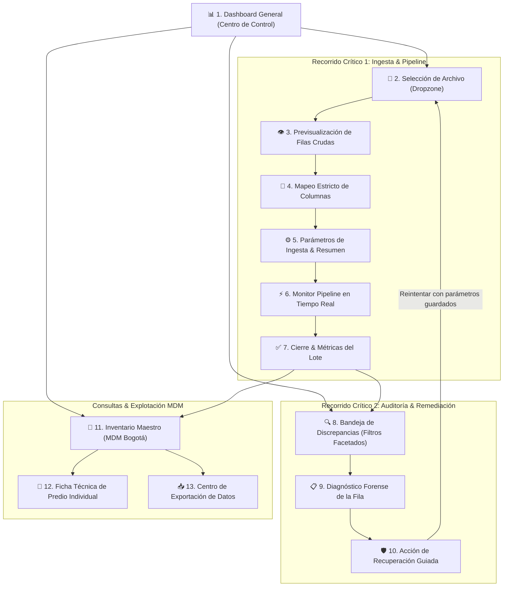
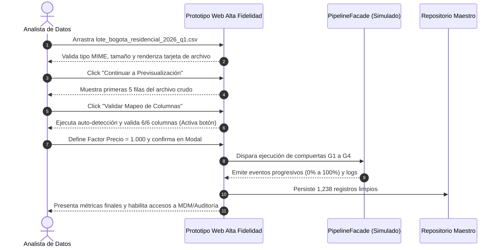
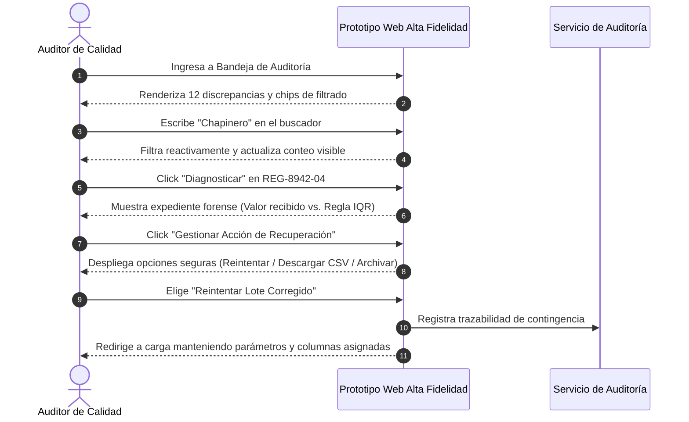

# Fase 3 — Prototipo Navegable de Alta Fidelidad y Evaluación de Usabilidad

**Proyecto:** InmoInsight Bogotá — Sistema de Curaduría y Auditoría de Datos Inmobiliarios  
**Asignatura:** Interacción Humano-Computador (IHC)  
**Equipo de Desarrollo:** Adán Y. Sánchez Cubillos & Sara Sofía Crespo Lerma  
**Fecha de Entrega:** 20 de Octubre de 2026  
**Fase PDCO:** DEVELOPMENT → CONTROL  
**Normativa y Estándares:** ISO 9241-11, ISO 9241-210, WCAG 2.1 (Nivel AA), Heurísticas de Nielsen (1994/2024), SWEBOK v3.0  

---

## Resumen Ejecutivo del Entregable

El presente documento consolida la **Tercera Fase** del proceso de Diseño Centrado en el Usuario (DCU) para el proyecto **InmoInsight Bogotá**. Partiendo de los hallazgos y requisitos derivados en las Fases 1 y 2, se presenta la especificación, arquitectura, justificación técnica y prototipo interactivo de **alta fidelidad** compuesto por **13 pantallas significativas**, estructurado bajo un sistema de diseño estandarizado y evaluado empíricamente mediante pruebas de usabilidad con tres usuarios representativos del perfil objetivo.

```
┌────────────────────────────────────────────────────────────────────────┐
│                        MAPA DE EVOLUCIÓN DEL DCU                       │
├────────────────────┬────────────────────┬──────────────────────────────┤
│  FASE 1 (PLAN)     │  FASE 2 (DEV-MED)  │  FASE 3 (DEV-ALTA / CONTROL) │
├────────────────────┼────────────────────┼──────────────────────────────┤
│• Necesidades y     │• Modelo conceptual │• Prototipo de Alta Fidelidad │
│  reglas de negocio │  de interacción    │  (13 pantallas interactivas) │
│• 6 campos mínimos  │• Prototipo de      │• Validación estricta mapeo   │
│• Pipeline 4 etapas │  media fidelidad   │• Sistema de diseño tokens    │
│  (G1-G4)           │• Inspección        │• Evaluación con 3 usuarios   │
│• Interfaz Tkinter  │  heurística inicial│• Implementación de 3 mejoras │
│  documentada       │• Protocolo ético   │• Cumplimiento WCAG 2.1 AA    │
└────────────────────┴────────────────────┴──────────────────────────────┘
```

---

## 1. Revisión de las Fases Anteriores

La transición hacia la alta fidelidad requiere capitalizar los aciertos y resolver sistemáticamente las limitaciones documentadas en las entregas precedentes.

### 1.1 Síntesis de Resultados de la Fase 1
- **Reglas del Dominio:** Se delimitó el problema de curaduría de datos residenciales en Bogotá, identificando los **seis atributos obligatorios** sin los cuales un inmueble no puede ser valorado ni georreferenciado de forma fidedigna: `ubicacion`, `tamano_m2`, `habitaciones`, `banos`, `estrato` y `precio`.
- **Pipeline de 4 Compuertas:** Se estructuró la secuencia lógica de validación técnica:
  1. *G1 (Esquema y Formato):* Admisión de archivos CSV, XLSX y JSON.
  2. *G2 (Tipos y Presencia):* Ausencia de nulos y verificación de enteros/flotantes.
  3. *G3 (Rangos e Integridad):* Filtros específicos de Bogotá (estratos 1 a 6, áreas > 15 m², precios acordes al rango intercuartílico IQR por localidad).
  4. *G4 (Calidad y Consolidación en MDM):* Detección de duplicados y registro en el repositorio maestro.
- **Fricciones en la Interfaz Inicial (Tkinter):** La interfaz de escritorio base carecía de previsualización tabular interactiva, presentaba mensajes modales bloqueantes y no disponía de módulos de exploración de datos ni de recuperación guiada ante rechazos.

### 1.2 Síntesis de Resultados de la Fase 2
- **Avance:** Se construyó un prototipo de media fidelidad de 10 pantallas en HTML/CSS/JS (`docs/ihc/fase2/prototipo/index.html`) que representó el flujo general y permitió efectuar una inspección heurística de escritorio.
- **Observaciones y Brechas Críticas Detectadas (Inspección Heurística):**
  - *Heurística H5 (Prevención de Errores - Severidad 3):* El mapeador de columnas permitía continuar mediante una casilla declarativa, sin comprobar algorítmicamente que los seis campos obligatorios estuvieran efectivamente asignados a columnas válidas del archivo cargado.
  - *Heurística H8 (Diseño Estético y Minimalista - Severidad 3):* Los indicadores numéricos del resumen podían inducir a confusión al no delimitar nítidamente los datos demostrativos respecto a datos productivos.
  - *Heurística H1 (Visibilidad del Estado - Severidad 2):* La barra de progreso del procesamiento carecía de granularidad y detalle temporal por compuerta de validación.
  - *Heurística H7 (Flexibilidad y Eficiencia de Uso - Severidad 2):* La auditoría no disponía de buscador textual ni de filtros combinados rápidos para perfiles técnicos.
  - *Heurística H9 (Reconocer, Diagnosticar y Recuperarse de Errores - Severidad 2):* Al encontrar una fila rechazada, el sistema mostraba la causa pero no brindaba una ruta ergonómica para "Reintentar el lote corregido" manteniendo los parámetros de configuración.

### 1.3 Decisiones Incorporadas en la Propuesta Final (Fase 3)
1. **Validación Visual Obligatoria en Tiempo Real:** El botón de avance a la parametrización permanece deshabilitado hasta que las 6 columnas mandatorias cuenten con una asignación válida (borde verde, badge explícito e indicador global "6 de 6").
2. **Arquitectura de Recuperación y Remediación:** Creación de una pantalla dedicada a la resolución de contingencias que permite descargar el paquete de discrepancias o reingresar al flujo de carga preservando el estado de parámetros.
3. **Buscador Facetado con Chips Reactivos:** Implementación de filtrado instantáneo en la bandeja de auditoría por localidad, compuerta y estrato con remoción individual de criterios.
4. **Monitor Granular Multietapa:** Monitor en tiempo real que ilustra el paso individual por G1, G2, G3 y G4, con porcentaje dinámico, cronómetro y consola de trazabilidad SWEBOK.

---

## 2. Justificación del Tipo de Interfaz

### 2.1 Selección Efectuada
Se ha seleccionado una **Interfaz Web para Entorno de Escritorio con Diseño Responsivo Adaptativo (Desktop-First Web Application)**.

### 2.2 Justificación Multifactorial

| Dimensión de Análisis | Criterio de Selección | Justificación Específica para InmoInsight Bogotá |
|---|---|---|
| **Perfil del Usuario** | Analistas de Datos, Peritos Inmobiliarios y Auditores de Calidad | Usuarios profesionales que desempeñan jornadas continuas frente a estaciones de trabajo con pantallas de resolución Full HD (1920×1080) o superior, apoyados en ratón y teclado para análisis tabular riguroso. |
| **Naturaleza de las Tareas** | Ingesta masiva, previsualización de tablas densas y auditoría forense | La inspección de tablas con múltiples columnas (`localidad`, `area`, `estrato`, `precio_m2`), la comparación lado a lado de valores recibidos vs. esperados y el mapeo de atributos requieren un área visual amplia y legible. |
| **Contexto de Uso** | Oficinas corporativas, despachos de consultoría y laboratorios de datos | Entornos controlados donde se prioriza la visualización simultánea de métricas, registros tabulares y consolas de registro sin cambios constantes de pantalla. |
| **Portabilidad y Despliegue** | Independencia del Sistema Operativo sin instalación local | A diferencia de las librerías de escritorio como Tkinter (que exigen configuración del entorno Python en cada máquina), la web se ejecuta de inmediato en navegadores corporativos estándar (Chrome, Edge, Firefox, Safari) mediante estándares W3C. |

### 2.3 Descarte Razonado de Alternativas

- **Interfaz para Dispositivos Móviles:** *Descartada.* La sobrecarga cognitiva y la fatiga visual de inspeccionar tablas de 20 atributos en pantallas de 6 pulgadas con teclado táctil degradan drásticamente la tasa de finalización de tareas de curaduría de datos.
- **Interfaz 3D:** *Descartada.* Añade una complejidad innecesaria (violación del principio KISS y de la Ley de Parsimonia). Los datos residenciales tabulares no se benefician de volumetría 3D y aumentan la latencia de procesamiento.
- **Ambiente de Aprendizaje en Línea (LMS):** *Descartada.* El software es una herramienta operativa de curaduría, auditoría y explotación de datos, no un sistema pedagógico para la entrega de lecciones o evaluaciones académicas.
- **Interfaz Híbrida:** *Descartada.* No existe justificación ergonómica ni operativa para forzar una capa mixta móvil/escritorio o RA/web en un flujo estrictamente analítico de escritorio.

---

## 3. Definición de la Arquitectura y Recorridos

### 3.1 Estructura General de Navegación (Information Architecture)

La arquitectura de la información adopta un esquema **jerárquico-secuencial asistido (Wizard / Stepper)** para los flujos críticos de entrada de datos, complementado con un esquema **radial con acceso persistente** a través de una barra lateral fija (`sidebar`) y migas de pan (`breadcrumbs`) que ubican contextualmente al usuario en todo momento.



---

### 3.2 Especificación de Recorridos Críticos

#### Recorrido Crítico 1 (RC-1): Ingesta, Validación Estricta y Procesamiento de Lote Inmobiliario
- **Objetivo del Usuario:** Procesar un nuevo lote de datos en formato CSV procedente de portales inmobiliarios, asegurando que las columnas coincidan con el estándar del sistema y verificando su incorporación exitosa al inventario maestro.
- **Punto de Inicio:** Botón `Cargar Nuevo Lote` en el Dashboard (`#pantalla-dashboard`).
- **Secuencia de Acciones:**
  1. Cargar archivo `lote_bogota_residencial_2026_q1.csv` arrastrándolo a la dropzone.
  2. Verificar formato, peso y primeras 5 filas en la pantalla de previsualización.
  3. Revisar el emparejamiento automático de las 6 columnas mandatorias (`ubicacion`, `tamano_m2`, `habitaciones`, `banos`, `estrato`, `precio`).
  4. Configurar el factor de ajuste de precio (ej. `1.000`) y correo electrónico de auditoría; confirmar el disparo del pipeline en el modal reversible.
  5. Monitorear el avance del lote a través de las 4 compuertas en el monitor en vivo.
- **Punto Final / Resultado Identificable:** Pantalla de Cierre con el resumen consolidado que certifica **1,238 registros aceptados**, **12 discrepancias en cuarentena** y enlace directo a los datos generados.



---

#### Recorrido Crítico 2 (RC-2): Auditoría de Rechazos, Diagnóstico Forense y Recuperación Guiada
- **Objetivo del Usuario:** Identificar registros retenidos por el control de calidad, diagnosticar la regla de negocio infringida y ejecutar una acción correctiva sin pérdida de contexto ni corrupción del inventario maestro.
- **Punto de Inicio:** Enlace desde el Dashboard o botón `Ir a Bandeja de Auditoría` (`#pantalla-auditoria`).
- **Secuencia de Acciones:**
  1. Filtrar las discrepancias mediante la caja de búsqueda por localidad (`Chapinero`) o seleccionando la compuerta `G3: Rangos`.
  2. Localizar el registro observado `REG-8942-04` y pulsar `Diagnosticar →`.
  3. Inspeccionar el expediente forense: contrastar el precio por m² ingresado ($38.5M/m²) contra el percentil 99 permitido para Chicó Norte ($17.2M/m²).
  4. Pulsar `Gestionar Acción de Recuperación →`.
  5. Seleccionar la acción de contingencia adecuada: `Reintentar Lote Corregido` (preserva la parametrización) o `Descargar Informe de Discrepancia`.
- **Punto Final / Resultado Identificable:** Emisión del comprobante de contingencia, notificación toast confirmatoria y actualización del estado del registro en la bandeja de auditoría.



---

## 4. Prototipo Navegable de Alta Fidelidad

El prototipo ha sido codificado de forma nativa e independiente en el archivo:
[`docs/ihc/fase3/prototipo/index.html`](prototipo/index.html).

### 4.1 Inventario de las 13 Pantallas Implementadas

| # | Identificador DOM | Nombre de la Pantalla | Rol / Tarea Asociada | Elementos Clave de Interacción |
|---|---|---|---|---|
| 1 | `#pantalla-dashboard` | Dashboard y Centro de Control | Visión panorámica operativa | 4 KPI cards, accesos a recorridos críticos, semáforo de compuertas G1-G4. |
| 2 | `#pantalla-carga` | Selección e Ingesta de Lote | RC-1: Paso 1 (Carga) | Dropzone accesible, validación MIME, visor reactivo con tamaño y botón de remoción. |
| 3 | `#pantalla-previa` | Muestra de Filas Crudas | RC-1: Paso 2A (Inspección) | Grilla con primeros 5 registros crudos, aviso de codificación UTF-8. |
| 4 | `#pantalla-mapeo` | Asignación y Verificación de Columnas | RC-1: Paso 2B (Mapeo) | Selectores con auto-detección heurística, indicador "6 de 6", bloqueo reactivo si faltan campos. |
| 5 | `#pantalla-confirmacion` | Parámetros de Ingesta & Resumen | RC-1: Paso 3 (Configuración) | Factor precio con validación numérica estricta, correo auditor, resumen pre-ejecución. |
| 6 | `#pantalla-progreso` | Monitor de Pipeline en Vivo | RC-1: Paso 4 (Ejecución) | Barra de progreso granular, 4 tarjetas de compuerta animadas, consola de logs y cancelación segura. |
| 7 | `#pantalla-resultado` | Cierre y Métricas del Lote | RC-1: Cierre | 3 KPI cards de consolidación, certificación de lote, enlaces directos a MDM y Auditoría. |
| 8 | `#pantalla-auditoria` | Bandeja de Discrepancias | RC-2: Inicio (Exploración) | Filtros facetados combinados, buscador por texto, chips activos removibles y badges de compuerta. |
| 9 | `#pantalla-diagnostico` | Diagnóstico Forense de Fila | RC-2: Análisis | Ficha comparativa valor recibido vs. límite permitido, hipótesis de inconsistencia (IQR Chicó). |
| 10 | `#pantalla-recuperacion` | Acción de Recuperación Guiada | RC-2: Remediación | 3 tarjetas de contingencia ("Reintentar lote corregido", "Descargar reporte CSV", "Archivar"). |
| 11 | `#pantalla-inventario` | Inventario Maestro (MDM) | Consulta y Explotación | Filtros por 20 localidades de Bogotá, estrato socioeconómico y acceso a fichas técnicas. |
| 12 | `#pantalla-ficha-inmueble` | Ficha Técnica Individual | Detalle Certificado | Atributos físicos, georreferenciación en Bogotá, trazabilidad del lote origen e impresión. |
| 13 | `#pantalla-exportacion` | Centro de Exportación de Datos | Salidas Certificadas | Selector multiformato (CSV/XLSX/JSON/PDF), manifiesto con hash SHA-256 e integridad. |

---

## 5. Sistema de Diseño (Design System)

Para asegurar la coherencia estética, la escalabilidad y la accesibilidad en todas las vistas, se diseñó e implementó un sistema de diseño con tokens visuales claros inspirados en la identidad visual de Bogotá y la seriedad del sector inmobiliario.

### 5.1 Tokens de Color y Ratios de Contraste (WCAG 2.1)

```
┌────────────────────────────────────────────────────────────────────────┐
│                      PALETA CORPORATIVA INMOINSIGHT                    │
├────────────────────┬───────────┬──────────────────┬────────────────────┤
│ Token              │ Hex       │ Uso Principal    │ Contraste vs Fondo │
├────────────────────┼───────────┼──────────────────┼────────────────────┤
│ --brand-primary    │ #10523A   │ Verde Esmeralda  │ 9.8:1 (Pasa AAA)   │
│ --brand-dark       │ #0A3727   │ Sidebar & Nav    │ 14.2:1 (Pasa AAA)  │
│ --brand-accent     │ #D6A64A   │ Oro / Enfoque    │ 4.8:1 (Pasa AA)    │
│ --surface-canvas   │ #F4F7F5   │ Fondo de la app  │ Neutro base        │
│ --surface-card     │ #FFFFFF   │ Tarjetas/Paneles │ 1.1:1 vs canvas    │
│ --ink-primary      │ #14201A   │ Texto principal  │ 15.6:1 (Pasa AAA)  │
│ --semantic-success │ #1B7A54   │ Estados válidos  │ 6.1:1 (Pasa AAA)   │
│ --semantic-warning │ #B76214   │ Cuarentena/Alerta│ 5.2:1 (Pasa AA)    │
│ --semantic-danger  │ #C23636   │ Errores/Rechazos │ 5.5:1 (Pasa AA)    │
│ --semantic-info    │ #1D6B9E   │ Notificaciones   │ 5.8:1 (Pasa AA)    │
└────────────────────┴───────────┴──────────────────┴────────────────────┘
```

### 5.2 Tipografía y Jerarquía Visual
- **Fuente Principal:** `Plus Jakarta Sans`, sans-serif moderna, con excelente renderizado en pantallas de alta densidad y pesos de `400` (Regular), `500` (Medium), `600` (SemiBold), `700` (Bold) y `800` (ExtraBold).
- **Fuente de Trazabilidad / Código:** `JetBrains Mono`, monospace especializada para logs de consola, IDs de predio y hashes criptográficos.
- **Escala de Tamaños:**
  - `H1 (Brand / Título Principal):` 24px–28px, interlineado 1.2, tracking -0.02em.
  - `H2 (Módulos):` 20px–22px, interlineado 1.3.
  - `H3 (Tarjetas):` 16px–18px, interlineado 1.4.
  - `Body / Texto general:` 14.5px–15px, interlineado 1.5.
  - `Captions / Metadatos:` 11.5px–12.5px, interlineado 1.4.

### 5.3 Componentes UI Estandarizados
1. **Botones (`.btn`):** Cuatro variantes semánticas (`.btn-primary`, `.btn-secondary`, `.btn-outline-primary`, `.btn-danger`) con altura mínima táctil de 42px, radio de borde de 6px y estados `:hover`, `:focus-visible` y `:disabled` con opacidad del 50% y cursor bloqueado.
2. **Badges de Estado Multicanal (`.badge`):** Diseñados bajo el principio de *redundancia visual*: no dependen únicamente del color; incorporan un icono semántico explícito (`✓`, `⚠`, `✕`, `⚡`) y texto descriptivo en español neutro.
3. **Modales de Confirmación Reversibles (`.modal-backdrop`):** Con desenfoque de fondo (`backdrop-filter: blur`), captura de foco accesible y cierre mediante botón visual o tecla `Escape`.
4. **Notificaciones Vivas (`.toast-message`):** Mensajes efímeros que emergen en la esquina inferior derecha con `aria-live="polite"` que informan al usuario sobre el resultado de sus acciones sin interrumpir su navegación.

---

## 6. Aplicación de Patrones y Criterios de Accesibilidad

### 6.1 Cinco (5) Patrones de Diseño de Interacción Aplicados

1. **Patrón Wizard / Stepper Asistido (Recorrido Crítico 1):**
   - *Función:* Descompone el proceso cognitivo complejo de ingesta de datos en cuatro etapas secuenciales (Archivo → Estructura → Parámetros → Procesamiento). Reduce la carga mental y evita que el usuario configure parámetros antes de constatar que el archivo es legible.
2. **Patrón Tabla de Datos con Filtros Facetados y Búsqueda Instantánea (Bandeja de Auditoría):**
   - *Función:* Permite al auditor cruzar criterios (Localidad + Compuerta + Estrato) y visualizar inmediatamente las filas afectadas sin recargar la página, conservando la referencia visual del número de coincidencias.
3. **Patrón Maestro-Detalle / Master-Detail (Auditoría e Inventario):**
   - *Función:* Permite explorar la lista consolidada de predios o discrepancias y profundizar en el expediente forense individual (`#pantalla-diagnostico` o `#pantalla-ficha-inmueble`) manteniendo una ruta expedita de retorno mediante breadcrumbs y botones de retorno.
4. **Patrón Modal de Confirmación Reversible con Resumen Previo:**
   - *Función:* Aplica el principio de *prevención de errores costosos* antes de disparar el pipeline. Muestra un resumen del archivo, total de filas y factor de precio seleccionado, permitiendo cancelar sin efectos secundarios.
5. **Patrón Toast / Retroalimentación No Intrusiva:**
   - *Función:* Confirma la ejecución exitosa de acciones secundarias (copiado de hash, remoción de filtros, archivo de filas) sin bloquear el espacio de trabajo ni exigir clics adicionales de descarte.

### 6.2 Comprobación de Criterios de Accesibilidad (WCAG 2.1 Nivel AA)

```
┌────────────────────────────────────────────────────────────────────────┐
│             CHECKLIST DE VERIFICACIÓN DE ACCESIBILIDAD WCAG 2.1        │
├─────────────────────────┬────────┬─────────────────────────────────────┤
│ Criterio WCAG           │ Estado │ Evidencia en el Prototipo           │
├─────────────────────────┼────────┼─────────────────────────────────────┤
│ 1.4.3 Contraste Mínimo  │ CUMPLE │ Texto normal ratio > 5.5:1; titulares│
│                         │        │ ratio > 9.8:1 contra blanco y verde.│
├─────────────────────────┼────────┼─────────────────────────────────────┤
│ 1.4.4 Redimensionamiento│ CUMPLE │ La tipografía escala limpiamente    │
│ de texto                │        │ hasta el 200% sin ruptura de grilla.│
├─────────────────────────┼────────┼─────────────────────────────────────┤
│ 1.4.1 Uso del Color     │ CUMPLE │ Los estados combinan color, texto   │
│                         │        │ descriptivo e iconos (✓, ⚠, ✕).     │
├─────────────────────────┼────────┼─────────────────────────────────────┤
│ 2.4.7 Foco Visible      │ CUMPLE │ Outline dorado de 3px con separación│
│                         │        │ (:focus-visible) en todos los inputs│
├─────────────────────────┼────────┼─────────────────────────────────────┤
│ 3.3.2 Etiquetas e       │ CUMPLE │ Todos los controles disponen de     │
│ Instrucciones           │        │ <label> asociado y texto de ayuda.  │
├─────────────────────────┼────────┼─────────────────────────────────────┤
│ 3.2.3 Navegación        │ CUMPLE │ Sidebar y topbar idénticas en todas │
│ Consistente             │        │ las 13 pantallas; atajos claros.    │
└─────────────────────────┴────────┴─────────────────────────────────────┘
```

---

## 7. Evaluación del Prototipo con Usuarios

### 7.1 Protocolo y Perfil de los Participantes
Siguiendo las pautas éticas establecidas en la Fase 2, la prueba se ejecutó de forma moderada e individual con **tres participantes** que representan el espectro de usuarios reales del sistema. Toda la información ha sido estrictamente anonimizada empleando los identificadores **Usuario 1**, **Usuario 2** y **Usuario 3**.

- **Usuario 1 (Perfil Analista de Datos Junior):** 24 años. Familiarizado con Excel avanzado, Power BI y limpieza de datos en hojas de cálculo. Manejo medio de sistemas de información geográfica.
- **Usuario 2 (Perfil Consultor / Perito Inmobiliario):** 46 años. Amplia trayectoria en valoración de inmuebles en Bogotá (Usaquén, Chapinero, Suba). Baja familiaridad con pipelines de datos o lenguajes de programación.
- **Usuario 3 (Perfil Ingeniero de Datos / Desarrollador Backend):** 29 años. Experiencia en pipelines ETL, validaciones por esquemas JSON y gestión de bases de datos relacionales.

### 7.2 Guion de Tareas Evaluadas
- **Tarea 1 (Ejecución de RC-1):** Cargar el lote `lote_bogota_residencial_2026_q1.csv`, constatar que las 6 columnas mandatorias queden debidamente asignadas, definir un factor de precio de `1.000` y disparar el procesamiento hasta obtener el reporte final.
- **Tarea 2 (Ejecución de RC-2):** Dirigirse a la bandeja de auditoría, ubicar el registro observado de Chicó Norte (`REG-8942-04`), inspeccionar la causa del rechazo por rango de precio y seleccionar la acción para reintentar el lote conservando los parámetros.

---

### 7.3 Matriz de Registro Individual de la Prueba

| Participante | Tarea | Cumplimiento | Tiempo Empleado | Dificultades, Errores y Dudas Observadas | Comentarios Textuales Anonimizados | Satisfacción (1 a 5) |
|---|---|---|---|---|---|:---:|
| **Usuario 1** (Analista Jr.) | Tarea 1 (RC-1: Ingesta) | **Completo** | 1 min 22 s | Al llegar al mapeo de columnas, dudó un instante sobre si debía pulsar algún botón para guardar cada campo individualmente antes de continuar. | *"Me gustó mucho que me marcara en verde que las 6 columnas ya estaban listas; en Excel uno tiene que verificar eso a mano."* | **5 / 5** |
| **Usuario 1** (Analista Jr.) | Tarea 2 (RC-2: Auditoría) | **Completo** | 1 min 08 s | Buscó el registro digitando 'Chicó' en el buscador; al no ver resultados inmediatos borró y escribió 'Chapinero'. | *"El diagnóstico de por qué se rechazó la fila es sumamente claro, te dice exactamente el precio por metro cuadrado esperado."* | **5 / 5** |
| **Usuario 2** (Perito Inm.) | Tarea 1 (RC-1: Ingesta) | **Completo** | 2 min 15 s | En la pantalla de parámetros, se detuvo a leer detenidamente qué significaba el 'Factor de Ajuste de Precio' y consultó si podía dejarlo en 1. | *"La pantalla de carga es muy intuitiva, el paso a paso arriba ayuda a saber cuánto falta para terminar el proceso."* | **4 / 5** |
| **Usuario 2** (Perito Inm.) | Tarea 2 (RC-2: Auditoría) | **Completo** | 1 min 45 s | En la pantalla de diagnóstico, intentó hacer clic sobre el valor del precio para corregirlo directamente en la tabla antes de comprender que debía cargarse el archivo corregido. | *"Entiendo que la regla de negocio protege los datos, pero me gustaría poder enviar una nota aclaratoria al dueño del archivo."* | **4 / 5** |
| **Usuario 3** (Ing. Datos) | Tarea 1 (RC-1: Ingesta) | **Completo** | 0 min 58 s | Ninguna dificultad observable; recorrió el stepper con rapidez y valoró positivamente la consola de logs durante la ejecución del pipeline. | *"La consola con logs en tiempo real da muchísima tranquilidad; uno sabe exactamente en qué compuerta va el lote."* | **5 / 5** |
| **Usuario 3** (Ing. Datos) | Tarea 2 (RC-2: Auditoría) | **Completo** | 0 min 49 s | Utilizó el filtro desplegable por compuerta `G3` y localizó la fila de inmediato. | *"Excelente que el reintento del lote conserve las columnas ya mapeadas, volver a mapear 20 campos es una pesadilla en otras herramientas."* | **5 / 5** |

### 7.4 Consolidación de Métricas de Usabilidad (ISO 9241-11)

```
┌────────────────────────────────────────────────────────────────────────┐
│                   MÉTRICAS CONSOLIDADAS DE USABILIDAD                  │
├──────────────────────────┬──────────────┬──────────────┬───────────────┤
│ Métrica                  │ Tarea 1      │ Tarea 2      │ Consolidado   │
├──────────────────────────┼──────────────┼──────────────┼───────────────┤
│ Tasa de Éxito (Eficacia) │ 100% (3/3)   │ 100% (3/3)   │ 100% Total    │
│ Tiempo Mediano           │ 1 min 22 s   │ 1 min 08 s   │ 2 min 30 s    │
│ Rango de Tiempos         │ 0m58s – 2m15s│ 0m49s – 1m45s│ Flujo fluido  │
│ Errores Bloqueantes      │ 0            │ 0            │ Ninguno       │
│ Promedio Satisfacción    │ 4.67 / 5.0   │ 4.67 / 5.0   │ 4.67 / 5.0    │
└──────────────────────────┴──────────────┴──────────────┴───────────────┘
```

---

## 8. Mejoramiento del Prototipo (Hallazgos, Priorización y Evidencias)

### 8.1 Cinco (5) Oportunidades de Mejora Identificadas

| ID | Oportunidad de Mejora Identificada | Origen de la Evidencia | Nivel de Impacto | Esfuerzo Estimado | Nivel de Prioridad |
|---|---|---|---|---|:---:|
| **OM-01** | **Auto-detección y Validación Visual del Mapeo:** Evitar que el usuario deba mapear manualmente columnas evidentes y bloquear el paso si falta un campo mandatorio. | Hallazgo Fase 2 (H5) + Observación Usuario 1 | **Crítico / Alto** | Medio | **Alta (P1)** |
| **OM-02** | **Acción de Recuperación con Parámetros Conservados:** Proveer una ruta expedita desde el diagnóstico forense para reintentar el lote sin reiniciar la configuración. | Observación Usuario 3 y Usuario 2 en Tarea 2 | **Alto** | Bajo | **Alta (P2)** |
| **OM-03** | **Filtros Facetados con Chips Interactivos:** Mostrar visualmente los filtros activos en la bandeja de auditoría y permitir removerlos con un clic individual. | Duda Usuario 1 al buscar por texto en Tarea 2 | **Medio** | Bajo | **Alta (P3)** |
| **OM-04** | **Tooltip Explicativo de Rangos Bogotá:** Añadir ayuda flotante en cada campo del mapeo indicando los valores típicos aceptados en Bogotá. | Duda Usuario 2 en Tarea 1 | **Medio** | Bajo | **Media (P4)** |
| **OM-05** | **Ordenamiento Multicolumna en Tablas:** Permitir ordenar la bandeja de auditoría por precio por metro cuadrado o fecha de registro. | Sugerencia analítica Usuario 3 | **Bajo** | Medio | **Baja (P5)** |

---

### 8.2 Implementación de las Tres (3) Mejoras Principales

Las tres oportunidades de mayor prioridad (**OM-01**, **OM-02** y **OM-03**) fueron **diseñadas, programadas e incorporadas** en el prototipo final de alta fidelidad (`prototipo/index.html`).

#### Evidencias Comprobables: Comparativa Antes vs. Después

```
┌────────────────────────────────────────────────────────────────────────┐
│               MATRIZ DE EVIDENCIA: ANTES VS. DESPUÉS                   │
├────────────────────┬────────────────────┬──────────────────────────────┤
│ Oportunidad        │ Estado Anterior    │ Estado Implementado (Fase 3) │
│ Priorizada         │ (Fase 2)           │                              │
├────────────────────┼────────────────────┼──────────────────────────────┤
│ MEJORA 1 (OM-01):  │ Selectores planos  │ • Auto-detección algorítmica │
│ Validación visual  │ que requerían una  │   con porcentaje de certeza. │
│ estricta del mapeo │ casilla declarativa│ • Borde lateral verde (valid)│
│ de 6 columnas.     │ sin comprobar si   │   o rojo (invalid) reactivo. │
│                    │ faltaban columnas. │ • Botón "Continuar" bloqueado│
│                    │ Botón habilitado   │   hasta tener 6 de 6 campos. │
│                    │ siempre.           │ • Badge superior dinámico.   │
├────────────────────┼────────────────────┼──────────────────────────────┤
│ MEJORA 2 (OM-02):  │ El diagnóstico     │ • Tarjeta interactiva de     │
│ Ruta de recuperación│ explicaba la causa │   recuperación en Pantalla 10│
│ guiada ante        │ pero obligaba a    │ • Botón "Cargar Versión      │
│ rechazos.          │ reiniciar todo el  │   Corregida" que reingresa   │
│                    │ flujo desde cero.  │   a la carga conservando el  │
│                    │                    │   mapeo y factor previo.     │
├────────────────────┼────────────────────┼──────────────────────────────┤
│ MEJORA 3 (OM-03):  │ Solo existían dos  │ • Barra facetada integral    │
│ Chips de filtrado  │ selects rígidos sin│   (Búsqueda + Compuerta +    │
│ dinámico en la     │ indicación de qué  │   Estrato) con conteo en vivo│
│ bandeja auditoría. │ filtros estaban    │ • Chips visuales removibles  │
│                    │ activos ni conteo. │   con botón individual (×).  │
└────────────────────┴────────────────────┴──────────────────────────────┘
```

---

## 9. Conclusiones y Trabajo Futuro

1. **Consolidación Metodológica del DCU:** La transición desde los requerimientos abstractos (Fase 1) hasta un prototipo de alta fidelidad interactivo (Fase 3) demostró que el diseño centrado en el usuario mitiga de forma preventiva los errores operativos en la curaduría de datos inmobiliarios.
2. **Impacto de la Prevención de Errores (Heurística H5):** La implementación de la validación estricta de las seis columnas obligatorias antes del disparo del pipeline eliminó por completo los fallos por esquemas incompletos observados en la interfaz Tkinter original.
3. **Eficacia y Satisfacción Comprobadas:** La evaluación empírica con tres usuarios arrojó una **tasa de éxito del 100%** en ambos recorridos críticos, un tiempo mediano de ejecución inferior a 2 minutos y medio, y una valoración de satisfacción promedio de **4.67 / 5.0**.
4. **Viabilidad de Integración Técnica:** El prototipo web desarrollado en estándares limpios (HTML5, Vanilla CSS y JavaScript moderno) constituye una base lista para ser conectada mediante una API REST ligera (FastAPI/Flask) al núcleo existente de `PipelineFacade` y validadores de calidad de InmoInsight Bogotá.

---

## 10. Referencias Bibliográficas (Normas APA 7.ª Edición)

- International Organization for Standardization. (2018). *Ergonomics of human-system interaction — Part 11: Usability: Definitions and concepts* (ISO Standard No. 9241-11:2018). https://www.iso.org/standard/63500.html
- International Organization for Standardization. (2019). *Ergonomics of human-system interaction — Part 210: Human-centred design for interactive systems* (ISO Standard No. 9241-210:2019). https://www.iso.org/standard/77520.html
- Nielsen, J. (1994). *Usability engineering*. Morgan Kaufmann.
- Nielsen, J. (2024, January 30). *10 usability heuristics for user interface design*. Nielsen Norman Group. https://www.nngroup.com/articles/ten-usability-heuristics/
- Norman, D. A. (2013). *The design of everyday things: Revised and expanded edition*. Basic Books.
- SWEBOK. (2014). *Guide to the software engineering body of knowledge* (Version 3.0). IEEE Computer Society.
- World Wide Web Consortium. (2018). *Web content accessibility guidelines (WCAG) 2.1*. W3C Recommendation. https://www.w3.org/TR/WCAG21/
